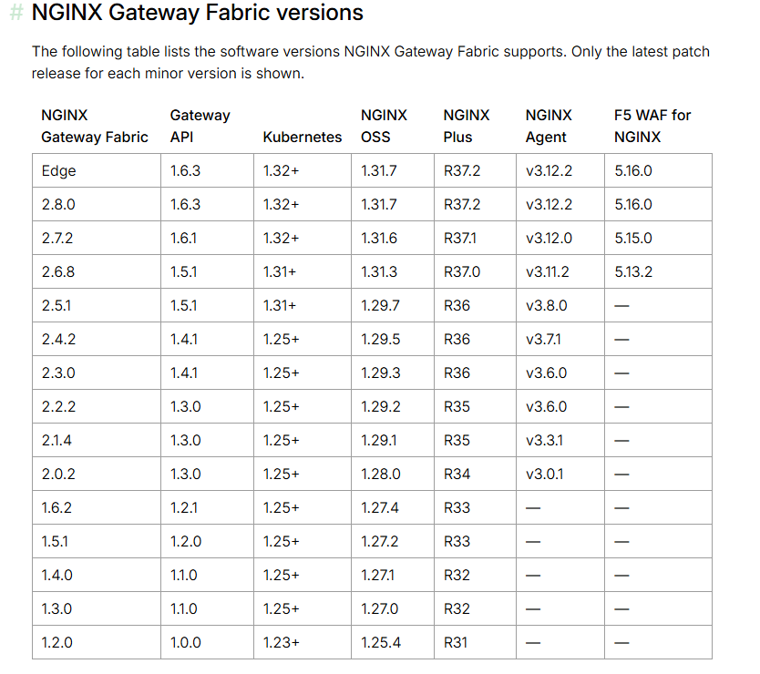

# 一，安装gatewayapi的crd资源

https://docs.nginx.com/nginx-gateway-fabric/overview/technical-specifications/#nginx-gateway-fabric-versions

gatewayapi和Nginx gateway Fabric 版本对应关系



```
#kubectl apply --server-side -f https://github.com/kubernetes-sigs/gateway-api/releases/download/v1.6.3/standard-install.yaml
# 网络不好使用代理
wget https://gh-proxy.org/https://github.com/kubernetes-sigs/gateway-api/releases/download/v1.6.3/standard-install.yaml
kubectl apply --server-side -f standard-install.yaml
```


```
root@k8s-master01:~# kubectl apply --server-side -f standard-install.yaml
customresourcedefinition.apiextensions.k8s.io/backendtlspolicies.gateway.networking.k8s.io serverside-applied
customresourcedefinition.apiextensions.k8s.io/gatewayclasses.gateway.networking.k8s.io serverside-applied
customresourcedefinition.apiextensions.k8s.io/gateways.gateway.networking.k8s.io serverside-applied
customresourcedefinition.apiextensions.k8s.io/grpcroutes.gateway.networking.k8s.io serverside-applied
customresourcedefinition.apiextensions.k8s.io/httproutes.gateway.networking.k8s.io serverside-applied
customresourcedefinition.apiextensions.k8s.io/listenersets.gateway.networking.k8s.io serverside-applied
customresourcedefinition.apiextensions.k8s.io/referencegrants.gateway.networking.k8s.io serverside-applied
customresourcedefinition.apiextensions.k8s.io/tcproutes.gateway.networking.k8s.io serverside-applied
customresourcedefinition.apiextensions.k8s.io/tlsroutes.gateway.networking.k8s.io serverside-applied
customresourcedefinition.apiextensions.k8s.io/udproutes.gateway.networking.k8s.io serverside-applied
validatingadmissionpolicy.admissionregistration.k8s.io/safe-upgrades.gateway.networking.k8s.io serverside-applied
validatingadmissionpolicybinding.admissionregistration.k8s.io/safe-upgrades.gateway.networking.k8s.io serverside-applied

```

参考： https://gateway-api.sigs.k8s.io/guides/getting-started/introduction/#install-standard-channel

参考： https://github.com/kubernetes-sigs/gateway-api

```
# 查看crd资源
kubectl get crd | grep gateway.networking.k8s.io
```


```
# 查看crd资源
root@k8s-master01:~# kubectl get crd | grep gateway.networking.k8s.io
backendtlspolicies.gateway.networking.k8s.io            2026-10-27T08:17:30Z
gatewayclasses.gateway.networking.k8s.io                2026-10-27T08:17:30Z
gateways.gateway.networking.k8s.io                      2026-10-27T08:17:30Z
grpcroutes.gateway.networking.k8s.io                    2026-10-27T08:17:30Z
httproutes.gateway.networking.k8s.io                    2026-10-27T08:17:30Z
listenersets.gateway.networking.k8s.io                  2026-10-27T08:17:30Z
referencegrants.gateway.networking.k8s.io               2026-10-27T08:17:31Z
tcproutes.gateway.networking.k8s.io                     2026-10-27T08:17:31Z
tlsroutes.gateway.networking.k8s.io                     2026-10-27T08:17:31Z
udproutes.gateway.networking.k8s.io                     2026-10-27T08:17:31Z


```

# 二，安装nginx gateway  fabric 的crd资源


nginx gateway fabric  crd

github地址：https://github.com/nginx/nginx-gateway-fabric/releases

```
# kubectl kustomize "https://github.com/nginx/nginx-gateway-fabric/config/crd/gateway-api/standard?ref=v2.8.0" | kubectl apply -f -
# 如果网络好可以直接部署
kubectl apply -f https://raw.githubusercontent.com/nginx/nginx-gateway-fabric/v2.8.0/deploy/crds.yaml
# 一般没有网络,使用代理
# kubectl apply -f https://gh-proxy.org/https://raw.githubusercontent.com/nginx/nginx-gateway-fabric/v2.8.0/deploy/crds.yaml
# 下载下来执行
wget https://gh-proxy.org/https://raw.githubusercontent.com/nginx/nginx-gateway-fabric/v2.8.0/deploy/crds.yaml
kubectl apply --server-side -f crds.yaml

# 查看crd资源
kubectl get crd | grep gateway.nginx.org
```


```
root@k8s-master01:~# kubectl apply --server-side -f crds.yaml
customresourcedefinition.apiextensions.k8s.io/accesspolicies.gateway.nginx.org serverside-applied
customresourcedefinition.apiextensions.k8s.io/authenticationfilters.gateway.nginx.org serverside-applied
customresourcedefinition.apiextensions.k8s.io/clientsettingspolicies.gateway.nginx.org serverside-applied
customresourcedefinition.apiextensions.k8s.io/externalloadbalancers.gateway.nginx.org serverside-applied
customresourcedefinition.apiextensions.k8s.io/nginxgateways.gateway.nginx.org serverside-applied
customresourcedefinition.apiextensions.k8s.io/nginxproxies.gateway.nginx.org serverside-applied
customresourcedefinition.apiextensions.k8s.io/observabilitypolicies.gateway.nginx.org serverside-applied
customresourcedefinition.apiextensions.k8s.io/payloadprocessors.gateway.nginx.org serverside-applied
customresourcedefinition.apiextensions.k8s.io/proxysettingspolicies.gateway.nginx.org serverside-applied
customresourcedefinition.apiextensions.k8s.io/ratelimitpolicies.gateway.nginx.org serverside-applied
customresourcedefinition.apiextensions.k8s.io/snippetsfilters.gateway.nginx.org serverside-applied
customresourcedefinition.apiextensions.k8s.io/snippetspolicies.gateway.nginx.org serverside-applied
customresourcedefinition.apiextensions.k8s.io/upstreamsettingspolicies.gateway.nginx.org serverside-applied
customresourcedefinition.apiextensions.k8s.io/wafpolicies.gateway.nginx.org serverside-applied
root@k8s-master01:~# kubectl get crd | grep gateway.nginx.org
accesspolicies.gateway.nginx.org                        2026-10-27T08:20:34Z
authenticationfilters.gateway.nginx.org                 2026-10-27T08:20:35Z
clientsettingspolicies.gateway.nginx.org                2026-10-27T08:20:35Z
externalloadbalancers.gateway.nginx.org                 2026-10-27T08:20:35Z
nginxgateways.gateway.nginx.org                         2026-10-27T08:20:35Z
nginxproxies.gateway.nginx.org                          2026-10-27T08:20:35Z
observabilitypolicies.gateway.nginx.org                 2026-10-27T08:20:35Z
payloadprocessors.gateway.nginx.org                     2026-10-27T08:20:35Z
proxysettingspolicies.gateway.nginx.org                 2026-10-27T08:20:35Z
ratelimitpolicies.gateway.nginx.org                     2026-10-27T08:20:35Z
snippetsfilters.gateway.nginx.org                       2026-10-27T08:20:35Z
snippetspolicies.gateway.nginx.org                      2026-10-27T08:20:35Z
upstreamsettingspolicies.gateway.nginx.org              2026-10-27T08:20:35Z
wafpolicies.gateway.nginx.org                           2026-10-27T08:20:36Z
```

# 三，安装nginx gateway fabric

使用helm部署

下载helm工具

github地址： https://github.com/helm/helm

下载地址：  https://get.helm.sh/helm-v4.3.1-linux-amd64.tar.gz


```
wget https://get.helm.sh/helm-v4.3.1-linux-amd64.tar.gz
tar zxf helm-v4.3.1-linux-amd64.tar.gz
mv linux-amd64/helm /usr/local/bin/helm
helm version
```

```
root@k8s-master01:~# wget https://get.helm.sh/helm-v4.3.1-linux-amd64.tar.gz
--2026-10-27 15:41:42--  https://get.helm.sh/helm-v4.3.1-linux-amd64.tar.gz
Resolving get.helm.sh (get.helm.sh)... 150.171.110.137, 2603:1061:14:184::1
Connecting to get.helm.sh (get.helm.sh)|150.171.110.137|:443... connected.
HTTP request sent, awaiting response... 200 OK
Length: 20368240 (19M) [application/x-tar]
Saving to: ‘helm-v4.3.1-linux-amd64.tar.gz’

helm-v4.3.1-linux-amd64.tar.gz                      100%[===================================================================================================================>]  19.42M  7.68MB/s    in 2.5s    

2026-10-27 15:41:48 (7.68 MB/s) - ‘helm-v4.3.1-linux-amd64.tar.gz’ saved [20368240/20368240]

root@k8s-master01:~# tar zxf helm-v4.3.1-linux-amd64.tar.gz 
root@k8s-master01:~# ls
calico-yml  disable-apt-update.sh  helm-v4.3.1-linux-amd64.tar.gz  kubeadm_init  linux-amd64  MetalLB-yml
root@k8s-master01:~# mv linux-amd64/helm /usr/local/bin/helm
root@k8s-master01:~# helm version
version.BuildInfo{Version:"v4.3.1", GitCommit:"c0d08d0d6d9424d4a14febb5e8a3e51b0dd00dff", GitTreeState:"clean", GoVersion:"go1.27.2", KubeClientVersion:"v1.37"}

```


安装nginx gateway fabric

参考： https://docs.nginx.com/nginx-gateway-fabric/install/helm/

```
mkdir ~/ngfdir && cd ~/ngfdir
helm pull oci://ghcr.io/nginx/charts/nginx-gateway-fabric --version 2.8.0 --untar
cd nginx-gateway-fabric/

```

命令参数安装

```
helm install ngf . --create-namespace -n nginx-gateway --set nginx.service.type=LoadBalancer --set nginx.service.externalTrafficPolicy=Cluster --set nginxGateway.snippetsFilters.enable=true
```

通过values-prod.yaml 安装

参数根据命令参数进行修改

```
# values-prod.yaml
# NGINX Gateway Fabric v2.8.0 生产环境配置（国内镜像版）
# Chart: oci://ghcr.io/nginx/charts/nginx-gateway-fabric --version 2.8.0

# ========== 控制面 (Control Plane) ==========
nginxGateway:
  replicas: 3

  # 控制面镜像：替换为阿里云杭州仓库
  image:
    repository: registry.cn-hangzhou.aliyuncs.com/mcalico/nginx-gateway-fabric
    tag: "2.8.0"
    pullPolicy: IfNotPresent

  resources:
    requests:
      cpu: 100m
      memory: 128Mi
    limits:
      cpu: 500m
      memory: 256Mi

  # 优雅终止：给 leader election 释放和配置下发留出时间
  lifecycle:
    preStop:
      exec:
        command:
          - /bin/sh
          - -c
          - sleep 10

  # 控制面就绪探针
  readinessProbe:
    enable: true
    port: 8081
    initialDelaySeconds: 5
    periodSeconds: 10
    failureThreshold: 3
    timeoutSeconds: 1
    successThreshold: 1

  productTelemetry:
    enable: false

  autoscaling:
    enable: false

  automountServiceAccountToken: false

# ========== 数据面 (Data Plane / NGINX) ==========
nginx:
  replicas: 3

  # 数据面镜像：已扁平化路径，避免与官方 nginx 镜像混淆
  image:
    repository: registry.cn-hangzhou.aliyuncs.com/mcalico/nginx-gateway-fabric-nginx
    tag: "2.8.0"
    pullPolicy: IfNotPresent

  # 优雅终止：滚动更新时等待 kube-proxy/LB 摘流后再退出
  lifecycle:
    preStop:
      exec:
        command:
          - /bin/sh
          - -c
          - sleep 10

  # 数据面就绪探针
  readinessProbe:
    enable: true
    port: 8081
    initialDelaySeconds: 5
    periodSeconds: 10
    failureThreshold: 3
    timeoutSeconds: 1
    successThreshold: 1

  container:
    resources:
      requests:
        cpu: 500m
        memory: 512Mi
      limits:
        cpu: "2"
        memory: 1Gi

  service:
    type: LoadBalancer
    externalTrafficPolicy: Cluster

# ========== 代码片段 ==========
snippets:
  enable: false

snippetsFilters:
  enable: false

# ========== Gateway API 实验特性 ==========
gwAPIExperimentalFeatures:
  enable: false

```

### 验证镜像是否生效

部署前用 `helm template` 确认两个 Deployment 中的 `image` 字段已指向阿里云地址：

bash

```
helm template ngf oci://ghcr.io/nginx/charts/nginx-gateway-fabric \
  --version 2.8.0 \
  -f values-prod.yaml \
  > rendered.yaml
```


在 `rendered.yaml` 中检查控制面与数据面 Deployment 的 `image` 行，应分别出现 `registry.cn-hangzhou.aliyuncs.com/mcalico/nginx-gateway-fabric:2.8.0` 和 `registry.cn-hangzhou.aliyuncs.com/mcalico/nginx-gateway-fabric-nginx:2.8.0`。如果渲染输出中仍然出现 `ghcr.io`，说明该字段的路径与当前 chart 版本不一致，需要回到 `helm show values` 的输出中核对实际键名。


**忽略**下面一些镜像替换过程。

```
# 查看镜像
grep 'repository:' values.yaml 

root@k8s-master01:~/ngfdir/nginx-gateway-fabric# grep 'repository:' values.yaml 
    repository: ghcr.io/nginx/nginx-gateway-fabric
    repository: ghcr.io/nginx/nginx-gateway-fabric/nginx
# 替换成国内镜像
  ghcr.io/nginx/nginx-gateway-fabric:2.8.0: registry.cn-hangzhou.aliyuncs.com/mcalico/nginx-gateway-fabric:2.8.0
  ghcr.io/nginx/nginx-gateway-fabric/nginx:2.8.0: registry.cn-hangzhou.aliyuncs.com/mcalico/nginx-gateway-fabric-nginx:2.8.0
  
 # 上传阿里云镜像，使用本地代理环境下载镜像。
 
docker login registry.cn-hangzhou.aliyuncs.com

# 输入自己的账号名，密码

#拉取镜像并上传的阿里云镜像仓库

docker pull ghcr.io/nginx/nginx-gateway-fabric:2.8.0
docker tag ghcr.io/nginx/nginx-gateway-fabric:2.8.0 registry.cn-hangzhou.aliyuncs.com/mcalico/nginx-gateway-fabric:2.8.0
docker push registry.cn-hangzhou.aliyuncs.com/mcalico/nginx-gateway-fabric:2.8.0

# 避免与官网nginx混淆把nginx-gateway-fabric/nginx:2.8.0 改成nginx-gateway-fabric-nginx:2.8.0，把俩层改成了一层路径。
docker pull ghcr.io/nginx/nginx-gateway-fabric/nginx:2.8.0
docker tag ghcr.io/nginx/nginx-gateway-fabric/nginx:2.8.0 registry.cn-hangzhou.aliyuncs.com/mcalico/nginx-gateway-fabric-nginx:2.8.0
docker push registry.cn-hangzhou.aliyuncs.com/mcalico/nginx-gateway-fabric-nginx:2.8.0 
 
 # 替换镜像
 # 优先替换nginx-gateway-fabric/nginx ，避免替换错误。
  sed -i 's+ghcr.io/nginx/nginx-gateway-fabric/nginx+registry.cn-hangzhou.aliyuncs.com/mcalico/nginx-gateway-fabric-nginx+g' values.yaml 
  sed -i 's+ghcr.io/nginx/nginx-gateway-fabric+registry.cn-hangzhou.aliyuncs.com/mcalico/nginx-gateway-fabric+g' values.yaml 
 
# 查看替换的镜像
root@k8s-master01:~/ngfdir/nginx-gateway-fabric# grep 'repository:' values.yaml 
    repository: registry.cn-hangzhou.aliyuncs.com/mcalico/nginx-gateway-fabric
    repository: registry.cn-hangzhou.aliyuncs.com/mcalico/nginx-gateway-fabric-nginx
# 查看修改后的文件
grep -vE '[[:space:]]*#|^[[:space:]]*$' values.yaml  
```

**安装**

```
helm install ngf . --create-namespace -n nginx-gateway -f values-prod.yaml
# 升级
helm upgrade --install ngf . --create-namespace -n nginx-gateway -f values-prod.yaml
```

```
root@k8s-master01:~/ngfdir/nginx-gateway-fabric# helm install ngf . --create-namespace -n nginx-gateway -f values-prod.yaml
NAME: ngf
LAST DEPLOYED: Tue Oct 27 18:13:12 2026
NAMESPACE: nginx-gateway
STATUS: deployed
REVISION: 1
DESCRIPTION: Install complete
TEST SUITE: None

```

查看运行的pod

```
root@k8s-master01:~/ngfdir/nginx-gateway-fabric# kubectl get pod -n nginx-gateway 
NAME                                        READY   STATUS    RESTARTS   AGE
ngf-nginx-gateway-fabric-85fcdb99fd-hfz7q   1/1     Running   0          40s
ngf-nginx-gateway-fabric-85fcdb99fd-p7hqh   1/1     Running   0          14s
ngf-nginx-gateway-fabric-85fcdb99fd-z8tcb   1/1     Running   0          27s

# gatewayclass 已安装成功
root@k8s-master01:~/ngfdir/nginx-gateway-fabric# kubectl get gatewayclass
NAME    CONTROLLER                                   ACCEPTED   AGE
nginx   gateway.nginx.org/nginx-gateway-controller   True       73s

# 查看svc
root@k8s-master01:~# kubectl get svc -n nginx-gateway 
NAME                       TYPE        CLUSTER-IP     EXTERNAL-IP   PORT(S)            AGE
ngf-nginx-gateway-fabric   ClusterIP   10.97.27.122   <none>        443/TCP,9113/TCP   40h
```

安装失败卸载

```
helm uninstall ngf -n nginx-gateway
```


# 四，配置gateway

**本地新建YAML清单，定义一个NGINX网关入口，监听80端口并接收以“jiamiao.com”结尾的域名访问，将流量转发给集群里的服务。Gateway是实际入口，负责监听端口、协议和域名。**


```
root@k8s-master01:~# vim gateway.yml

# 写入下列内容
apiVersion: gateway.networking.k8s.io/v1		# 固定配置
kind: Gateway			# 资源类型
metadata:
  name: jiamiaogateway	# 网关的名称
spec:
  # 使用NGINX作为网关驱动，也就是“kubectl get gatewayclasses.gateway.networking.k8s.io”显示的nginx
  gatewayClassName: nginx
  listeners:			# 定义一个监听器，监听器可以指定协议(HTTP、HTTPS)、端口、域名范围，可以类比nginx 的server，监听的IP就是gateway实际获取的IP。
    - name: default		# 监听入口名称为default
      hostname: "*.jiamiao.com"	# 处理以“.jiamiao.com”结尾的域名
      port: 80			# 监听80端口
      protocol: HTTP	# 监听HTTP请求
      allowedRoutes:	# 允许绑定到这个网关的路由
        namespaces:		# 允许的命名空间
          from: All		# 允许所有命名空间
```

**基于YAML清单向Kubernetes集群声明式地创建Gateway资源。**

```
kubectl create -f gateway.yml
```

 **验证：查询集群中所有网关资源的状态，能够看到刚刚我们创建的Gateway，且已经正常分配地址。**

```
kubectl get gateway
```


```
root@k8s-master01:~# cd ngfdir/
root@k8s-master01:~/ngfdir# vi gateway.yml
root@k8s-master01:~/ngfdir# kubectl create -f gateway.yml 
gateway.gateway.networking.k8s.io/jiamiaogateway created
root@k8s-master01:~/ngfdir# kubectl get gateway
NAME             CLASS   ADDRESS         PROGRAMMED   AGE
jiamiaogateway   nginx   192.168.3.181   True         110s
root@k8s-master01:~/ngfdir# kubectl get svc
NAME                    TYPE           CLUSTER-IP       EXTERNAL-IP     PORT(S)        AGE
jiamiaogateway-nginx    LoadBalancer   10.109.131.129   192.168.3.181   80:31950/TCP   2m32s
kubernetes              ClusterIP      10.96.0.1        <none>          443/TCP        6d18h
nginx-ingress-service   ClusterIP      10.102.170.173   <none>          80/TCP         17h


```

可以看到EXTERNAL-IP 是绑定到gateway 实例 jiamiaogateway 上面的，而不是service   ngf-nginx-gateway-fabric 上。


# 五，部署应用

**本地新建YAML清单，分别定义Deployment和Service资源描述模板。**

```
root@k8s-master:~# vim deployment-service.yml

# 写入下列内容
apiVersion: apps/v1		# 固定配置
kind: Deployment		# 资源类型
metadata:
  name: gateway-deployment
  labels:					# 定义标签
    app: gateway-deployment	# 自定义标签（键和值均可自定义）
spec:
  replicas: 3				# 预期数量为3
  selector:
    matchLabels:			# 标签匹配模式：精确匹配
      app: gateway-deployment	# 匹配的标签值
  template:			# 根据此模板来新建Pod
    metadata:
      labels:		# 给Pod加上标签，需要和selector定义一致
        app: gateway-deployment
    spec:
      containers:
        - name: nginx
          image: registry.cn-hangzhou.aliyuncs.com/mcalico/nginx:1.31.8
          imagePullPolicy: IfNotPresent
          ports:
            - containerPort: 80
---
apiVersion: v1		# 固定配置
kind: Service		# 资源类型
metadata:
  name: gateway-service
  labels:					# 定义标签
    app: gateway-deployment	# 自定义标签（键和值均可自定义）
spec:
  type: ClusterIP
  selector:				# 标签选择器，匹配后端Pod
    # 匹配后端Pod的标签，需要和上述Deployment名称对应
    app: gateway-deployment
  ports:
    - protocol: TCP		# 使用TCP协议
      port: 80  		# Service自己暴露的端口
      targetPort: 80	# 后端Pod实际监听的端口
```


**基于YAML清单向Kubernetes集群声明式地创建Deployment和Service资源。**

```
kubectl apply -f deployment-service.yml
```

```
root@k8s-master01:~/ngfdir# vim deployment-service.yml
root@k8s-master01:~/ngfdir# kubectl apply -f deployment-service.yml
deployment.apps/gateway-deployment created
service/gateway-service created
root@k8s-master01:~/ngfdir# kubectl get pod -l app=gateway-deployment
NAME                                  READY   STATUS    RESTARTS   AGE
gateway-deployment-5c98f86997-9jm8w   1/1     Running   0          2m34s
gateway-deployment-5c98f86997-nt5gv   1/1     Running   0          2m34s
gateway-deployment-5c98f86997-szhq2   1/1     Running   0          2m34s
root@k8s-master01:~/ngfdir# kubectl get svc -l app=gateway-deployment
NAME              TYPE        CLUSTER-IP       EXTERNAL-IP   PORT(S)   AGE
gateway-service   ClusterIP   10.105.132.116   <none>        80/TCP    2m43s

```


# 六，配置路由httprouter

**本地新建YAML清单，定义NGINX网关入口，监听80端口并接收以“jiamiao.com”结尾的域名访问，将流量转发给集群里的服务。HTTPRoute是Gateway的子资源，用于定义具体的流量转发规则。通过匹配Host、路径、Header等条件，将请求转发到后端服务。一个Gateway可以关联多个HTTPRoute，一个HTTPRoute也可以被多个Gateway引用。**


```
root@k8s-master:~# vim httproute.yml

# 写入下列内容
apiVersion: gateway.networking.k8s.io/v1		# 固定配置
kind: HTTPRoute			# 资源类型
metadata:
  name: jiamiao-httproute
spec:
  parentRefs:			# 绑定到名为jiamiaogateway的网关
    - name: jiamiaogateway
  hostnames: ['gateway.jiamiao.com']		# 只处理域名gateway.jiamiao.com
  rules:				# 路由规则
    - matches:			# 匹配条件
      - path:			# 按照URL路径匹配
          type: PathPrefix		# 匹配方式：路径前缀匹配
          value: /		# 所有路径以/开头，也就是匹配所有请求
    # 将流量转发给后端名为gateway-service的Service，端口为80
      backendRefs:
        - name: gateway-service
          port: 80
```


`[Step8]` **基于YAML清单向Kubernetes集群声明式地创建HTTPRoute资源。**


```
root@k8s-master:~# kubectl create -f httproute.yml
```


`[Step9]` **验证：查看当前集群中所有HTTP路由规则，能够看到上述我们创建的规则。**


```
root@k8s-master:~# kubectl get httproutes.gateway.networking.k8s.io
```

```
root@k8s-master01:~/ngfdir# vim httproute.yml
root@k8s-master01:~/ngfdir# kubectl create -f httproute.yml
httproute.gateway.networking.k8s.io/jiamiao-httproute created
root@k8s-master01:~/ngfdir# kubectl get httproutes
NAME                HOSTNAMES                 AGE
jiamiao-httproute   ["gateway.jiamiao.com"]   3m37s


```


# 七，测试

查看gateway的 IP

```
kubectl get gateway
```

```
root@k8s-master01:~/ngfdir# kubectl get gateway
NAME             CLASS   ADDRESS         PROGRAMMED   AGE
jiamiaogateway   nginx   192.168.3.181   True         26m

```

配置hosts解析

```
echo "192.168.3.181 gateway.jiamiao.com" >> /etc/hosts
```

```
root@k8s-master01:~/ngfdir# echo "192.168.3.181 gateway.jiamiao.com" >> /etc/hosts

```

访问gateway.jiamiao.com

```
root@k8s-master01:~/ngfdir# curl http://gateway.jiamiao.com
<!DOCTYPE html>
<html>
<head>
<title>Welcome to nginx!</title>
<style>
html { color-scheme: light dark; }
body { width: 35em; margin: 0 auto;
font-family: Tahoma, Verdana, Arial, sans-serif; }
</style>
</head>
<body>
<h1>Welcome to nginx!</h1>
<p>If you see this page, nginx is successfully installed and working.
Further configuration is required for the web server, reverse proxy, 
API gateway, load balancer, content cache, or other features.</p>

<p>For online documentation and support please refer to
<a href="https://nginx.org/">nginx.org</a>.<br/>
To engage with the community please visit
<a href="https://community.nginx.org/">community.nginx.org</a>.<br/>
For enterprise grade support, professional services, additional 
security features and capabilities please refer to
<a href="https://f5.com/nginx">f5.com/nginx</a>.</p>

<p><em>Thank you for using nginx.</em></p>
</body>
</html>

```

